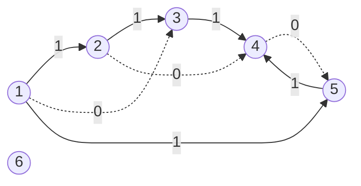

# Question 1: Shortest Path on Parity-Constrained Graphs via 0-1 BFS

[← Back to Lab 11 overview](../README.md)

## Contents

1. [Problem statement](#1-problem-statement)
2. [Reading the problem carefully](#2-reading-the-problem-carefully)
3. [File structure](#3-file-structure)
4. [Input representation](#4-input-representation)
5. [Key observations (with proofs)](#5-key-observations-with-proofs)
6. [The algorithm: 0-1 BFS on the doubled graph](#6-the-algorithm-0-1-bfs-on-the-doubled-graph)
7. [Correctness of 0-1 BFS](#7-correctness-of-0-1-bfs)
8. [Complexity analysis](#8-complexity-analysis)
9. [Worked example](#9-worked-example)
10. [Edge cases](#10-edge-cases)
11. [Alternatives that were considered](#11-alternatives-that-were-considered)
12. [Testing](#12-testing)
13. [Compile and run](#13-compile-and-run)
14. [Sample output](#14-sample-output)

---

## 1. Problem statement

We are given a directed graph $G=(V,E)$, a source vertex $S\in V$ and a penalty $C\ge 0$. Every edge $(u,v)\in E$ has a weight $w(u,v)\in\lbrace 0,1\rbrace$.

For a path $P$ starting at $S$ define

- $W(P)$: the sum of all edge weights on $P$,
- $k_1(P)$: the number of weight-1 edges on $P$,
- the **effective cost**

$$
\mathrm{Cost}(P)=W(P)+\begin{cases}0 & \text{if } k_1(P) \text{ is even},\\ C & \text{if } k_1(P) \text{ is odd.}\end{cases}
$$

**Goal.** For every vertex $v\in V$ compute

$$
\mathrm{Cost}^{*}(v)=\min_{P:\,S\leadsto v}\mathrm{Cost}(P),
$$

or report that $v$ is unreachable from $S$.

The twist compared with an ordinary shortest-path problem is that the price of a path does not only depend on its weight but also on the **parity** of the number of weight-1 edges it uses. A path that is "cheap" but has odd parity can lose against a slightly longer path with even parity.

---

## 2. Reading the problem carefully

Before designing the algorithm it is worth pinning down a few details, because they decide which algorithm is correct.

**(a) $W(P)=k_1(P)$.** The weights are only $0$ or $1$, so the sum of the weights is exactly the number of weight-1 edges. The cost therefore depends on one single integer $k=k_1(P)$:

$$
f(k)=k+C\cdot\left[k\text{ is odd}\right],\qquad \mathrm{Cost}(P)=f\bigl(k_1(P)\bigr).
$$

**(b) $f$ is not monotone.** For example with $C=3$ we get $f(0)=0,\ f(1)=4,\ f(2)=2,\ f(3)=6,\ f(4)=4$. So $f(1)\gt f(2)$: using *more* weight-1 edges can be *cheaper*. This is the reason a plain shortest-path computation on $W$ is not enough.

**(c) Walks instead of simple paths.** Following the usual convention for state-space shortest paths, a "path" here is a *walk*: vertices and edges may repeat. This matters, because the optimal walk may have to go around a cycle to repair the parity. Example: $S\to a$ with weight 1, $a\to b$ with weight 0, $b\to a$ with weight 1. The only simple path to $a$ has $k_1=1$ (odd) and costs $1+C$. The walk $S\to a\to b\to a$ has $k_1=2$ (even) and costs only $2$. For $C=3$ the answer for $a$ is $2$, and it needs a repeated vertex. (Restricting to simple paths would make parity-constrained shortest paths a much harder problem, so the walk reading is the standard, tractable one.)

**(d) Unreachable.** A vertex with no walk at all from $S$ is reported as `UNREACHABLE`. The source itself has the empty walk with $k_1=0$ and cost $0$.

---

## 3. File structure

```
question 1/
├── question 1.c     the program (menu: 1 = enter input, 2 = generate input, 0 = exit)
├── a.out            compiled binary (Linux x86-64)
└── readme.md        this file
```

---

## 4. Input representation

The graph is given as a list of directed edges. The program reads

| Order | Value | Meaning |
|---|---|---|
| 1 | `V` | number of vertices, numbered $1..V$ ($V\le 10^6$) |
| 2 | `E` | number of directed edges ($E\le 2\cdot 10^6$) |
| 3 | `S` | source vertex |
| 4 | `C` | penalty ($C\ge 0$, 64-bit) |
| 5 | `E` lines `u v w` | an edge $u\to v$ with weight `w` $\in\lbrace 0,1\rbrace$ |

### Why CSR (compressed sparse row) adjacency?

Three representations are natural:

| Representation | Memory | Iterate the out-edges of $u$ | Verdict |
|---|---|---|---|
| Adjacency matrix | $\Theta(V^2)$ | $\Theta(V)$ | impossible for $V=10^6$ (that is $10^{12}$ cells) |
| Array of linked lists | $\Theta(V+E)$ | $\Theta(\deg u)$, but pointer chasing | works, poor cache behaviour, one `malloc` per edge |
| **CSR arrays** | $\Theta(V+E)$ | $\Theta(\deg u)$, contiguous | **chosen** |

CSR uses three flat arrays. `start[u]` is the index in `to[]`/`wt[]` where the out-edges of $u$ begin; they end at `start[u+1]`. It is built with a counting pass (count out-degrees, prefix-sum them, then drop every edge into its slot), which costs $\Theta(V+E)$ and keeps edges of one vertex in input order.

For the sample graph of Section 9 (edges listed in input order $e_1,\dots,e_8$) the arrays are

```
vertex :   1        2        3     4     5     6
start  :   0        3        5     6     7     8  | 8   (start[7] = 8 closes the last vertex)
to     :  [2, 3, 5] [3, 4]   [4]   [5]   [4]
wt     :  [1, 0, 1] [1, 0]   [1]   [0]   [1]
```

### The doubled graph is implicit

The algorithm works on a graph with $2V$ *states* $(v,p)$, where $p\in\lbrace 0,1\rbrace$ is a parity bit. This graph is **never stored**. State $(v,p)$ is simply the integer $2v+p$, and its out-edges are read straight from the CSR arrays of $v$. This halves the memory a materialised doubled graph would need and removes a whole construction phase.

---

## 5. Key observations (with proofs)

### Lemma 1: the cost only needs two numbers per vertex

For a vertex $v$ let

$$
a_v=\min\bigl\lbrace k_1(P)\;:\;P\text{ is a walk }S\leadsto v,\ k_1(P)\text{ even}\bigr\rbrace,
\qquad
b_v=\min\bigl\lbrace k_1(P)\;:\;P\text{ is a walk }S\leadsto v,\ k_1(P)\text{ odd}\bigr\rbrace,
$$

with $\min\varnothing=\infty$. Then

$$
\boxed{\;\mathrm{Cost}^{*}(v)=\min\bigl(a_v,\; b_v+C\bigr)\;}
$$

**Proof.** Every walk $P$ to $v$ has $\mathrm{Cost}(P)=f(k_1(P))$. Split the walks into the even-parity class and the odd-parity class.

- In the even class $f(k)=k$, which is increasing in $k$, so the cheapest even walk is the one with the fewest weight-1 edges, giving cost $a_v$.
- In the odd class $f(k)=k+C$, which is also increasing in $k$, so the cheapest odd walk is the one with the fewest weight-1 edges, giving cost $b_v+C$.

The overall minimum is the smaller of the two class minima. $\blacksquare$

So the whole problem reduces to computing, for every vertex, **the minimum number of weight-1 edges over walks of each parity**.

### Lemma 2: a layered ("doubled") graph tracks the parity

Build the graph $G'$ with vertex set $V\times\lbrace 0,1\rbrace$ and, for every edge $(u,v,w)$ of $G$ and each $p\in\lbrace 0,1\rbrace$, the edge

$$
(u,p)\;\longrightarrow\;(v,\;p\oplus w)\qquad\text{with length } w,
$$

where $\oplus$ is XOR. A weight-0 edge keeps the parity bit, a weight-1 edge flips it.

**Claim.** Walks $S\leadsto v$ in $G$ whose $k_1$ has parity $p$ correspond exactly to walks $(S,0)\leadsto(v,p)$ in $G'$, and the $G'$-length of the walk equals $k_1$. Consequently

$$
a_v=\operatorname{dist}_{G'}\bigl((S,0),(v,0)\bigr),\qquad b_v=\operatorname{dist}_{G'}\bigl((S,0),(v,1)\bigr).
$$

**Proof.** By induction on the number of edges of the walk. The empty walk sits at $(S,0)$ with $k_1=0$, which is even. Suppose a walk of $G$ ends at $v$ with $k_1\equiv p\pmod 2$ and its image ends at $(v,p)$. Appending an edge $(v,x,w)$ changes $k_1$ to $k_1+w$, whose parity is $p\oplus w$, and the image moves along $(v,p)\to(x,p\oplus w)$. The $G'$-length grows by $w$, exactly like $k_1$. So the second coordinate always equals the parity of $k_1$ and the length always equals $k_1$. The correspondence is a bijection of walks, therefore shortest walks match. $\blacksquare$

### Lemma 3: plain BFS or Dijkstra on $W$ is not enough

Because $f$ is not monotone (observation 2b), the walk with the smallest $W$ is not always the cheapest. In the worked example of Section 9, vertex 4 has a walk with $k_1=1$ (cost $1+3=4$) but also a walk with $k_1=2$ (cost $2$). Any method that only remembers the single smallest distance would answer $4$ and be wrong. Keeping **one distance per parity** (Lemma 2) is exactly the missing information.

### Edge lengths in $G'$ are $0$ or $1$

So the shortest-path problem on $G'$ is a **0-1 shortest-path problem**, which a breadth-first search with a double-ended queue solves in linear time.

---

## 6. The algorithm: 0-1 BFS on the doubled graph

0-1 BFS is BFS in which a weight-0 relaxation puts the target at the **front** of the queue and a weight-1 relaxation puts it at the **back**.

```
dist[state]  <- -1 (unknown) for all 2V states
dist[(S,0)]  <- 0;  deque <- [(S,0)]
while deque is not empty:
    s <- pop_front();  if done[s]: continue          // stale duplicate
    done[s] <- true
    (u,p) <- s
    for each out-edge (u -> v, weight w):
        t  <- (v, p XOR w)
        nd <- dist[s] + w
        if dist[t] unknown or nd < dist[t]:
            dist[t] <- nd
            if w == 0: push_front(t) else push_back(t)
for each v:
    a <- dist[(v,0)],  b <- dist[(v,1)]
    Cost(v) <- min(a, b + C)           // ignore an unknown (infinite) term
    if both are unknown: UNREACHABLE
```

Implementation details of `question 1.c`:

- The deque is a **circular buffer** of fixed capacity $2E+4$. This is large enough because each of the $2E$ transitions is relaxed at most once (Section 8), so at most $2E+1$ entries are ever pushed.
- A `done[]` flag skips stale queue entries instead of using a decrease-key operation.
- Distances fit in `int` (a distance never exceeds $2V$), while the final cost $b_v+C$ is computed in `long long` so a large $C$ cannot overflow.

---

## 7. Correctness of 0-1 BFS

**Deque invariant.** Give every queue entry a *key*, the tentative distance it had when it was pushed. At every moment, read from front to back, the keys are non-decreasing and the largest key is at most the smallest key plus one:

$$
t_1\le t_2\le\dots\le t_m\le t_1+1 .
$$

*Proof by induction.* At the start there is one entry. Pop the front entry, key $d=t_1$. Every remaining key lies in $\lbrace d,d+1\rbrace$. Relaxing a weight-0 edge creates an entry with key $d$ and pushes it to the front, which is $\le$ every remaining key. Relaxing a weight-1 edge creates an entry with key $d+1$ and pushes it to the back, which is $\ge$ every remaining key. After the pushes the keys are still sorted and span at most one unit. $\blacksquare$

**Consequence.** Entries leave the deque in non-decreasing key order, exactly like in Dijkstra's algorithm. A state's smallest key is pushed no later than any larger key for the same state, and by the sorted order it is popped first. So when a state is popped for the first time, its key equals `dist[s]`, and any later copy is stale and skipped by `done[]`.

**Optimality (Dijkstra argument).** Suppose the first popped copy of some state $s$ had a key larger than its true distance $\delta(s)$. Take a shortest path to $s$ and its first state $y$ not yet settled; the predecessor $x$ on that path is settled with the correct distance, so relaxing $x\to y$ gave $y$ a key $\le\delta(s)$ (edge lengths are non-negative). By the sorted order $y$ must be popped before $s$, a contradiction with the choice of $s$ unless $y=s$. Hence every settled distance is exact. Since all states reachable from $(S,0)$ get relaxed, unreachable states keep the value $-1$.

Combining this with Lemma 1 and Lemma 2, `min(a, b + C)` is exactly $\mathrm{Cost}^{\ast}(v)$.

---

## 8. Complexity analysis

Let $n=\lvert V\rvert$ and $m=\lvert E\rvert$.

**Size of the doubled graph.** There are $2n$ states. Each original edge yields two transitions, one from $(u,0)$ and one from $(u,1)$, so there are $2m$ transitions.

**Number of relaxations.** A state is settled once (the `done[]` flag), and settling it scans its out-edges once. Summed over all states this is at most $2m$ relaxations.

**Number of queue operations.** Every push follows a successful relaxation, plus the initial push, so at most $2m+1$ pushes and as many pops. Each is $O(1)$ for a circular-buffer deque.

$$
T_{\text{BFS}}(n,m)=\underbrace{\Theta(n+m)}_{\text{CSR build}}+\underbrace{O(n)}_{\text{init}}+\underbrace{O(2n+2m)}_{\text{settle + relax}}=\Theta(n+m).
$$

This is optimal, because merely reading the input already takes $\Omega(n+m)$.

**Space.**

| Array | Size |
|---|---|
| `start` | $n+2$ ints |
| `to`, `wt` | $m$ ints each |
| `dist` | $2n$ ints |
| `done` | $2n$ bytes |
| deque | $2m+4$ ints |

Total $\Theta(n+m)$.

**Comparison.**

| Method | Time |
|---|---|
| Dijkstra with a binary heap on $G'$ | $O\bigl((n+m)\log n\bigr)$ |
| **0-1 BFS on $G'$ (used here)** | $\Theta(n+m)$ |
| One BFS per parity class, no layering | not correct (Lemma 3) |

**Measured.** For $n=10^6$ and $m=2\cdot 10^6$ random edges the whole program, including parsing $2\cdot 10^6$ input lines, runs in under a second on the test machine.

---

## 9. Worked example

Graph with $V=6$, source $S=1$ and penalty $C=3$. Edges in input order:

| Edge | $u\to v$ | $w$ |
|---|---|---|
| $e_1$ | 1 → 2 | 1 |
| $e_2$ | 2 → 3 | 1 |
| $e_3$ | 1 → 3 | 0 |
| $e_4$ | 3 → 4 | 1 |
| $e_5$ | 2 → 4 | 0 |
| $e_6$ | 4 → 5 | 0 |
| $e_7$ | 1 → 5 | 1 |
| $e_8$ | 5 → 4 | 1 |

Vertex 6 has no incident edge. Dashed arrows are weight-0 edges, solid arrows are weight-1 edges.



States are written $(v,e)$ for even parity and $(v,o)$ for odd parity. The deque is shown front to back with the key of each entry.

| Step | Pop (key) | Relaxations | Deque afterwards |
|---|---|---|---|
| 1 | $(1,e)$ (0) | $(2,o)=1$ pushed back; $(3,e)=0$ pushed **front**; $(5,o)=1$ pushed back | $(3,e){:}0,\ (2,o){:}1,\ (5,o){:}1$ |
| 2 | $(3,e)$ (0) | $(4,o)=1$ pushed back | $(2,o){:}1,\ (5,o){:}1,\ (4,o){:}1$ |
| 3 | $(2,o)$ (1) | $(3,e)$: candidate 2, not better than 0. $(4,o)$: candidate 1, not better than 1 | $(5,o){:}1,\ (4,o){:}1$ |
| 4 | $(5,o)$ (1) | $5\to4$ has weight 1, parity flips to even: $(4,e)=2$ pushed back | $(4,o){:}1,\ (4,e){:}2$ |
| 5 | $(4,o)$ (1) | $(5,o)$: candidate 1, not better | $(4,e){:}2$ |
| 6 | $(4,e)$ (2) | $4\to5$ has weight 0: $(5,e)=2$ pushed **front** | $(5,e){:}2$ |
| 7 | $(5,e)$ (2) | $(4,o)$: candidate 3, not better than 1 | empty |

Seven states are settled out of the twelve ($6\times2$); the five others, $(1,o),(2,e),(3,o)$ and both states of vertex 6, are unreachable.

Final answers, using $\mathrm{Cost}^{\ast}(v)=\min(a_v,b_v+C)$ with $C=3$:

| Vertex | $a_v$ (even) | $b_v$ (odd) | $\min(a_v,\ b_v+3)$ |
|---|---|---|---|
| 1 | 0 | none | **0** |
| 2 | none | 1 | $1+3=$ **4** |
| 3 | 0 | none | **0** |
| 4 | 2 | 1 | $\min(2,\ 1+3)=$ **2** |
| 5 | 2 | 1 | $\min(2,\ 1+3)=$ **2** |
| 6 | none | none | **UNREACHABLE** |

What the example illustrates:

- **Vertex 2** can only be reached with an odd number of weight-1 edges, so it must pay the penalty: $1+3=4$.
- **Vertices 4 and 5** have an odd walk with $k_1=1$ (cost $4$), but the longer even walk with $k_1=2$ (cost $2$) is cheaper. For vertex 4 that walk is $1\to5\to4$ (two weight-1 edges). This is the non-monotonicity of Section 2(b) in action, and the reason one distance per parity is kept.

---

## 10. Edge cases

| Case | Behaviour |
|---|---|
| $C=0$ | $\mathrm{Cost}^{\ast}(v)=\min(a_v,b_v)$, the ordinary 0-1 shortest-path distance |
| $C$ very large | the even class wins whenever it exists; vertices reachable only with odd parity pay $b_v+C$ (computed in 64 bits) |
| Unreachable vertex | both parities unknown, printed as `UNREACHABLE` |
| Source vertex | $(S,0)=0$, so $\mathrm{Cost}^{\ast}(S)=0$ (unless a cheaper odd walk exists, which cannot happen) |
| Weight-1 cycle through $v$ | lets a walk flip parity at the price of extra weight-1 edges; handled automatically by the state graph |
| Self-loops, parallel edges | allowed; a weight-1 self-loop on $v$ is a one-edge parity flip |
| $E=0$ | only the source is reachable |
| Weights other than 0 or 1 | rejected while reading the input |

---

## 11. Alternatives that were considered

1. **Dijkstra on the doubled graph.** Correct but $O((V+E)\log V)$; the heap is unnecessary because edge lengths are only 0 and 1.
2. **Ordinary BFS after splitting weight-1 edges.** Does not handle weight-0 edges (they would need contracting), and does not by itself record parity.
3. **Computing the minimum $k_1$ first and "fixing" the parity afterwards.** Wrong, as shown in Lemma 3: the best odd and best even counts can belong to completely different walks.
4. **Dynamic programming over $k_1$.** Needs $O(V)$ layers and gives $O(V(V+E))$; the parity argument shows only the first two layers of each class matter.

---

## 12. Testing

The program was compared with an independent brute force on 500 random graphs ($V\le 8$): the brute force computes, for each $k=0,1,2,\dots$, the set of vertices reachable by a walk with exactly $k$ weight-1 edges (closing under weight-0 edges), and takes the minimum of $f(k)$. All answers agreed. The program was also run under AddressSanitizer and UndefinedBehaviorSanitizer without reports.

---

## 13. Compile and run

```bash
gcc -O2 -Wall -Wextra "question 1.c" -o a.out
./a.out
```

The menu is: **1** enter input manually, **2** generate a random input, **0** exit.

---

## 14. Sample output

A manual run on the worked example of Section 9, then one random run, then exit. The random run is different on every execution. In the random run the generated edges are printed as `u->v:w`.

```
===== Parity-Constrained Shortest Paths (0-1 BFS) =====
1. Enter input manually
2. Generate input randomly
0. Exit
Choice: 1
Enter number of vertices V (1-1000000): 6
Enter number of directed edges E (0-2000000): 8
Enter source vertex S (1-6): 1
Enter penalty C (>= 0): 3
Enter 8 edges as 'u v w' with w = 0 or 1 (vertices 1..6):
1 2 1
2 3 1
1 3 0
3 4 1
2 4 0
4 5 0
1 5 1
5 4 1

V = 6, E = 8, source S = 1, odd-parity penalty C = 3
State graph: 12 states, 16 transitions; 7 states settled

Vertex 1: even=0 odd=- -> Cost = 0
Vertex 2: even=- odd=1 -> Cost = 4
Vertex 3: even=0 odd=- -> Cost = 0
Vertex 4: even=2 odd=1 -> Cost = 2
Vertex 5: even=2 odd=1 -> Cost = 2
Vertex 6: even=- odd=- -> Cost = UNREACHABLE

===== Parity-Constrained Shortest Paths (0-1 BFS) =====
1. Enter input manually
2. Generate input randomly
0. Exit
Choice: 2
Generated random input: V = 6, E = 12, S = 1, C = 4
Edges (u -> v : w): 2->6:0 4->3:1 6->5:1 3->5:1 1->6:1 3->6:0 1->2:1 3->4:1 1->4:1 3->5:1 3->2:1 3->6:0

V = 6, E = 12, source S = 1, odd-parity penalty C = 4
State graph: 12 states, 24 transitions; 8 states settled

Vertex 1: even=0 odd=- -> Cost = 0
Vertex 2: even=- odd=1 -> Cost = 5
Vertex 3: even=2 odd=- -> Cost = 2
Vertex 4: even=- odd=1 -> Cost = 5
Vertex 5: even=2 odd=3 -> Cost = 2
Vertex 6: even=2 odd=1 -> Cost = 2

===== Parity-Constrained Shortest Paths (0-1 BFS) =====
1. Enter input manually
2. Generate input randomly
0. Exit
Choice: 0
```
