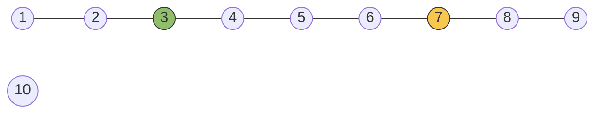

# Question 2: Multi-Source BFS for Radius-Constrained Voronoi Cell Partitioning

[← Back to Lab 11 overview](../README.md)

## Contents

1. [Problem statement](#1-problem-statement)
2. [Reading the problem carefully](#2-reading-the-problem-carefully)
3. [File structure](#3-file-structure)
4. [Input representation](#4-input-representation)
5. [Why one multi-source BFS](#5-why-one-multi-source-bfs)
6. [Key lemmas (with proofs)](#6-key-lemmas-with-proofs)
7. [The algorithm](#7-the-algorithm)
8. [Correctness proof](#8-correctness-proof)
9. [Complexity analysis](#9-complexity-analysis)
10. [Worked example](#10-worked-example)
11. [Edge cases](#11-edge-cases)
12. [Alternatives that were considered](#12-alternatives-that-were-considered)
13. [Testing](#13-testing)
14. [Compile and run](#14-compile-and-run)
15. [Sample output](#15-sample-output)

---

## 1. Problem statement

We are given

- an unweighted, undirected graph $G=(V,E)$,
- $K$ hub vertices $H=(h_1,\dots,h_K)$, indexed $1..K$,
- a radius $R\ge 0$.

Let $\operatorname{dist}(u,v)$ be the number of edges on a shortest path. For every vertex $v$ define

$$
d_i(v)=\operatorname{dist}(v,h_i),\qquad d_{\min}(v)=\min_{1\le i\le K} d_i(v).
$$

The ownership label $\mathrm{owner}[v]\in\lbrace 1,\dots,K\rbrace\cup\lbrace -1\rbrace$ is defined by

1. if $d_{\min}(v)\gt R$, then $\mathrm{owner}[v]=-1$ (outside the coverage area);
2. otherwise $\mathrm{owner}[v]$ is a hub $i$ that minimises $d_i(v)$;
3. ties are broken in favour of the **smallest hub index** $i$.

**Output.** For every vertex, its owner and the distance to that owner.

This is a **graph Voronoi diagram**: every vertex belongs to the cell of its nearest hub, with a radius cut-off and a deterministic tie-break.

---

## 2. Reading the problem carefully

- **Index, not vertex id.** Ties are resolved by the hub's *index* $i$ (its position in the list $h_1,\dots,h_K$), not by the vertex number of the hub. In the worked example the hub list is `7 3`, so hub 1 is vertex 7. A tie between them goes to hub 1 (vertex 7), even though vertex 3 has the smaller vertex id.
- **Radius is inclusive.** A vertex at distance exactly $R$ is covered; a vertex at distance $R+1$ is not.
- **Hubs own themselves.** A hub has $d_{\min}=0\le R$, so it belongs to its own cell with distance 0. Hubs are required to be distinct vertices.
- **Disconnected graphs.** A vertex that no hub can reach has $d_{\min}=\infty\gt R$ and gets $-1$.

---

## 3. File structure

```
question 2/
├── question 2.c     the program (menu: 1 = enter input, 2 = generate input, 0 = exit)
├── a.out            compiled binary (Linux x86-64)
└── readme.md        this file
```

---

## 4. Input representation

| Order | Value | Meaning |
|---|---|---|
| 1 | `V` | number of vertices, numbered $1..V$ ($V\le 10^6$) |
| 2 | `E` | number of undirected edges ($E\le 2\cdot 10^6$) |
| 3 | `E` lines `u v` | an undirected edge $\lbrace u,v\rbrace$ |
| 4 | `K` | number of hubs |
| 5 | `h1 ... hK` | the hub vertices, in index order, all distinct |
| 6 | `R` | the radius |

**Adjacency in CSR form.** Because the graph is undirected, every edge $\lbrace u,v\rbrace$ is stored twice (as $u\to v$ and $v\to u$) in two flat arrays: `start[]` of length $V+2$ and `adj[]` of length $2E$. The neighbours of $u$ are `adj[start[u] .. start[u+1]-1]`. Compared with an adjacency matrix ($\Theta(V^2)$ memory, impossible for $V=10^6$) or per-vertex linked lists (pointer chasing), CSR needs only $\Theta(V+E)$ memory and scans neighbours sequentially in memory, which is what BFS does all the time.

**Hubs** are kept as an array `hub[0..K-1]`; the owner of a vertex is stored as the 1-based hub index so that "smaller index wins" is a plain integer comparison.

---

## 5. Why one multi-source BFS

The obvious solution runs one BFS from every hub and then, for each vertex, takes the best of the $K$ answers. That costs $\Theta\bigl(K(V+E)\bigr)$ time and $\Theta(KV)$ memory if all $K$ distance arrays are kept.

The key idea is that all hubs can **share one BFS**: put every hub into the queue at distance 0 at the start. Imagine a virtual vertex $s^{\ast}$ joined to all hubs by edges. A BFS from $s^{\ast}$ visits the vertices exactly in order of $\min_i\operatorname{dist}(\cdot,h_i)$, because the shortest route from $s^{\ast}$ to $v$ enters the graph through whichever hub is nearest to $v$.

With one extra piece of bookkeeping (the owner label travelling along with the wavefront) the same search also answers *which* hub is nearest.

---

## 6. Key lemmas (with proofs)

For a vertex $v$ let

$$
\mathrm{Best}(v)=\bigl\lbrace\, i\;:\; d_i(v)=d_{\min}(v)\,\bigr\rbrace
$$

be the set of hubs at minimum distance. The required owner is $\min\mathrm{Best}(v)$ whenever $d_{\min}(v)\le R$.

### Lemma 1 (distances)

The BFS level of $v$ in the multi-source search equals $d_{\min}(v)$.

**Proof.** Induction on $d=d_{\min}(v)$. For $d=0$, $v$ is a hub and sits at level 0. For $d\ge 1$, take a shortest path from $v$ to its nearest hub; its neighbour $u$ on that path satisfies $d_{\min}(u)\le d-1$. Also $d_{\min}(u)\ge d-1$, since otherwise a closer hub would give $v$ a distance $\lt d$ through $u$. So $d_{\min}(u)=d-1$, $u$ is at level $d-1$ by induction, and when $u$ is processed it discovers $v$ (or $v$ was already discovered by another level-$(d-1)$ vertex). Hence $v$ is at level exactly $d$. $\blacksquare$

### Lemma 2 (the owner recursion)

If $d_{\min}(v)=d+1\ge 1$ then

$$
\mathrm{Best}(v)=\bigcup_{\substack{u\sim v\\ d_{\min}(u)=d}}\mathrm{Best}(u),
$$

where $u\sim v$ means $u$ and $v$ are adjacent. Therefore

$$
\mathrm{owner}(v)=\min_{\substack{u\sim v\\ d_{\min}(u)=d}}\mathrm{owner}(u).
$$

**Proof.** ($\supseteq$) Let $u\sim v$ with $d_{\min}(u)=d$ and let $i\in\mathrm{Best}(u)$. Then $d_i(v)\le d_i(u)+1=d+1$. Since $d_{\min}(v)=d+1$ the inequality cannot be strict, so $d_i(v)=d+1$ and $i\in\mathrm{Best}(v)$.

($\subseteq$) Let $i\in\mathrm{Best}(v)$, so $d_i(v)=d+1$. The first step of a shortest path from $v$ to $h_i$ is a neighbour $u$ with $d_i(u)=d$. By the triangle inequality $d_{\min}(u)\ge d_{\min}(v)-1=d$, and $d_{\min}(u)\le d_i(u)=d$. So $d_{\min}(u)=d$ and $i\in\mathrm{Best}(u)$.

The statement about owners follows by taking the minimum of both sides. $\blacksquare$

Lemma 2 says: *the owner of a vertex is the smallest owner among its neighbours one level closer to the hubs.* That is precisely what a BFS can compute while it sweeps level by level.

### Lemma 3 (cells are connected)

Every Voronoi cell induces a connected subgraph, and each vertex of a cell is joined to its hub inside the cell.

**Proof.** Let $\mathrm{owner}(v)=i$, $d_{\min}(v)=d$, and let $v=x_0,x_1,\dots,x_d=h_i$ be a shortest path to the hub. For each $j$ we have $d_{\min}(x_j)=d-j$ (it is at most $d_i(x_j)=d-j$, and at least $d-j$ by the triangle inequality). If some hub $i'$ were also at distance $d-j$ from $x_j$, then $d_{i'}(v)\le j+(d-j)=d$, so $i'\in\mathrm{Best}(v)$ and $i\le i'$ because $i$ is the smallest member of $\mathrm{Best}(v)$. Hence $\mathrm{owner}(x_j)=i$ for all $j$, and the whole path lies in the cell. $\blacksquare$

(This is why the picture of "territories" is meaningful: no cell is split into pieces.)

---

## 7. The algorithm

```
dist[v]  <- -1,  owner[v] <- -1  for all v
for i = 1..K:  dist[h_i] <- 0;  owner[h_i] <- i;  enqueue(h_i)       // sources in index order
while queue not empty:
    u <- dequeue()
    if dist[u] >= R: continue                  // radius reached: do not expand
    for each neighbour v of u:
        if dist[v] == -1:                      // first discovery
            dist[v] <- dist[u] + 1;  owner[v] <- owner[u];  enqueue(v)
        else if dist[v] == dist[u] + 1 and owner[u] < owner[v]:
            owner[v] <- owner[u]               // same level, smaller hub index wins
output owner[v] and dist[v] for every v      // vertices never reached keep owner = -1
```

Notes on the implementation (`question 2.c`):

- The queue is a plain array of size $V$ with a head and a tail index; each vertex is enqueued at most once.
- **Early termination at radius $R$.** A vertex at distance exactly $R$ is recorded but never expanded, so the search stops as soon as the whole $R$-neighbourhood of the hubs has been explored. Vertices farther than $R$ are never touched.
- **The tie rule is a safety net.** If the sources are enqueued in increasing index order, the queue is always sorted by owner index, so the first discoverer of a vertex already has the smallest owner and the `else if` branch never changes anything. Keeping the branch makes the correctness proof independent of that fact (for example it would still be correct if the hubs were enqueued in a different order).

---

## 8. Correctness proof

**Claim.** When the BFS ends, for every vertex $v$:

- if $d_{\min}(v)\le R$, then $\mathrm{dist}[v]=d_{\min}(v)$ and $\mathrm{owner}[v]=\min\mathrm{Best}(v)$;
- otherwise $\mathrm{dist}[v]=-1$ and $\mathrm{owner}[v]=-1$.

**Proof.** Induction on the level $d$.

*Base ($d=0$).* The hubs are enqueued with $\mathrm{dist}=0$ and $\mathrm{owner}=$ their own index, and $\mathrm{Best}(h_i)=\lbrace i\rbrace$, since hubs are distinct vertices at distance $0$ only from themselves.

*Step.* Assume every vertex of level $\le d$ (with $d\lt R$) has its correct distance, and that the owners of all level-$d$ vertices are correct and final when they are dequeued. The queue is processed level by level, so *every* level-$d$ vertex is dequeued before any level-$(d+1)$ vertex.

- By Lemma 1 a vertex $v$ with $d_{\min}(v)=d+1$ is discovered by some level-$d$ neighbour, and gets $\mathrm{dist}=d+1$.
- While the level-$d$ vertices are dequeued, $\mathrm{owner}[v]$ is set by the first discoverer and lowered whenever a later level-$d$ neighbour has a smaller owner. After the last level-$d$ vertex has been processed, $\mathrm{owner}[v]=\min\mathrm{owner}(u)$ over the level-$d$ neighbours $u$ of $v$, which equals $\min\mathrm{Best}(v)$ by Lemma 2.
- Because $v$ itself is only dequeued afterwards (it is at level $d+1$), its owner is final when it is used to label level $d+2$.

*Radius.* Vertices at level $R$ are not expanded, so no vertex with $d_{\min}\gt R$ is ever discovered, and those keep $-1$. A vertex with $d_{\min}\le R$ is discovered at its level $d_{\min}$ before the radius cut-off applies, because all its predecessors lie on levels $\lt d_{\min}\le R$ and are expanded. $\blacksquare$

---

## 9. Complexity analysis

Let $n=\lvert V\rvert$, $m=\lvert E\rvert$ and $K\le n$.

| Phase | Cost |
|---|---|
| Build CSR | $\Theta(n+m)$ |
| Initialise `dist`, `owner` | $\Theta(n)$ |
| Enqueue the hubs | $\Theta(K)$ |
| BFS | every vertex dequeued once; every adjacency entry scanned at most once (twice per edge, once from each endpoint) |
| Output | $\Theta(n)$ |

$$
T(n,m,K)=\Theta(n+m)\qquad\text{(and the BFS part alone is } O(n_R+m_R)\text{)},
$$

where $n_R$ is the number of vertices within distance $R$ of some hub and $m_R$ the number of edges scanned from them. When $R$ is small only the neighbourhood of the hubs is touched, even if the graph is huge.

**Space.** $\Theta(n+m)$: `start` ($n+2$), `adj` ($2m$), `dist`, `owner`, `queue` ($n$ each).

**Compared with $K$ separate BFS runs**, which cost $\Theta\bigl(K(n+m)\bigr)$, the shared search removes the factor $K$ entirely.

**Measured.** For $n=10^6$, $m=2\cdot10^6$, $K=1000$ hubs and $R=5$ the program visited $664\,308$ vertices and ran in about $0.7$ s including reading the input.

---

## 10. Worked example

Graph with $V=10$ and the path $1-2-3-4-5-6-7-8-9$; vertex 10 is isolated. Hubs `7 3` (so $h_1$ is vertex 7 and $h_2$ is vertex 3) and radius $R=2$.



Hub 1 (vertex 7) is yellow, hub 2 (vertex 3) is green. Distances to the two hubs:

| Vertex | 1 | 2 | 3 | 4 | 5 | 6 | 7 | 8 | 9 | 10 |
|---|---|---|---|---|---|---|---|---|---|---|
| $d_1$ (to vertex 7) | 6 | 5 | 4 | 3 | 2 | 1 | 0 | 1 | 2 | none |
| $d_2$ (to vertex 3) | 2 | 1 | 0 | 1 | 2 | 3 | 4 | 5 | 6 | none |

Vertex 5 is at distance 2 from **both** hubs, a tie, and the smaller index (hub 1) wins.

**BFS trace.** The queue is written front to back, and each entry is written `vertex(owner, dist)`.

| Step | Dequeue | What happens | Queue afterwards |
|---|---|---|---|
| init | | hubs enqueued in index order | 7(1,0), 3(2,0) |
| 1 | 7(1,0) | discovers 6 and 8, both with owner 1 at distance 1 | 3(2,0), 6(1,1), 8(1,1) |
| 2 | 3(2,0) | discovers 2 and 4, both with owner 2 at distance 1 | 6(1,1), 8(1,1), 2(2,1), 4(2,1) |
| 3 | 6(1,1) | discovers 5 with owner 1 at distance 2; neighbour 7 has distance 0, not $1+1$, ignored | 8(1,1), 2(2,1), 4(2,1), 5(1,2) |
| 4 | 8(1,1) | discovers 9 with owner 1 at distance 2 | 2(2,1), 4(2,1), 5(1,2), 9(1,2) |
| 5 | 2(2,1) | discovers 1 with owner 2 at distance 2 | 4(2,1), 5(1,2), 9(1,2), 1(2,2) |
| 6 | 4(2,1) | neighbour 5 already at distance 2 $=1+1$, but the candidate owner 2 is **not smaller** than 1: no change (the **tie** goes to hub 1) | 5(1,2), 9(1,2), 1(2,2) |
| 7 to 9 | 5, 9, 1 | their distance equals $R=2$, so they are not expanded | empty |

Result:

| Vertex | 1 | 2 | 3 | 4 | 5 | 6 | 7 | 8 | 9 | 10 |
|---|---|---|---|---|---|---|---|---|---|---|
| owner | 2 | 2 | 2 | 2 | **1** | 1 | 1 | 1 | 1 | $-1$ |
| distance | 2 | 1 | 0 | 1 | 2 | 1 | 0 | 1 | 2 | none |

Cell sizes: hub 1 owns $\lbrace5,6,7,8,9\rbrace$ (5 vertices), hub 2 owns $\lbrace1,2,3,4\rbrace$ (4 vertices), and 1 vertex (the isolated vertex 10) is uncovered. The BFS visited 9 of the 10 vertices.

What the example shows:

- **Tie at vertex 5**: equal distance 2, resolved by hub *index* (1) and not by vertex id (3 < 7).
- **Radius cut-off**: vertices 1, 5 and 9 sit at distance exactly $R=2$ and are not expanded; with $R=1$ vertices 1, 5 and 9 would be uncovered.
- **Connected cells** (Lemma 3): both cells are contiguous sub-paths.

---

## 11. Edge cases

| Case | Behaviour |
|---|---|
| $R=0$ | only the hubs are covered (owner = themselves, distance 0); everything else is $-1$ |
| $R$ larger than the graph diameter | every vertex in a component that contains a hub is covered |
| Vertex in a component with no hub | stays $-1$ |
| $K=1$ | ordinary single-source BFS truncated at depth $R$ |
| $K=V$ | every vertex is a hub, every cell has size 1 |
| Adjacent hubs | each owns itself; an edge between two cells is allowed |
| Duplicate hub vertices | rejected while reading the input (each hub must be a distinct vertex) |
| Parallel edges and self-loops | harmless: a self-loop never satisfies `dist[v] == -1` or $\mathrm{dist}+1$ |
| Equal distance to several hubs | the smallest index wins |

---

## 12. Alternatives that were considered

1. **$K$ separate BFS runs**, then a per-vertex minimum. Time $\Theta(K(V+E))$, memory $\Theta(KV)$.
2. **A priority queue** keyed by $(\text{distance},\text{owner})$, i.e. Dijkstra with lexicographic keys. It gives the same answer in $O((V+E)\log V)$ but is slower; unit edge weights make the ordered queue unnecessary.
3. **BFS with a global tie pass at the end.** Possible, but the per-level argument of Lemma 2 shows the tie can be resolved on the fly with no second pass.

---

## 13. Testing

The program was checked against an independent implementation that runs one BFS per hub, and then picks for every vertex the pair (smallest distance, smallest index) and applies the radius test. 500 random graphs with $V\le 12$, random hub sets and random radii all agreed. The program was also run under AddressSanitizer and UndefinedBehaviorSanitizer without reports.

---

## 14. Compile and run

```bash
gcc -O2 -Wall -Wextra "question 2.c" -o a.out
./a.out
```

The menu is: **1** enter input manually, **2** generate a random input, **0** exit.

---

## 15. Sample output

A manual run on the worked example of Section 10, then one random run, then exit. The random run is different on every execution.

```
===== Multi-Source BFS: Voronoi Cell Partitioning =====
1. Enter input manually
2. Generate input randomly
0. Exit
Choice: 1
Enter number of vertices V (1-1000000): 10
Enter number of undirected edges E (0-2000000): 8
Enter 8 edges as 'u v' (vertices 1..10):
1 2
2 3
3 4
4 5
5 6
6 7
7 8
8 9
Enter number of hubs K (1-10): 2
Enter the 2 distinct hub vertices h1..hK: 7 3
Enter radius R (>= 0): 2

V = 10, E = 8, K = 2 hubs, radius R = 2
Hubs (index: vertex): 1:7 2:3

Vertex 1: owner=2 (hub vertex 3) dist=2
Vertex 2: owner=2 (hub vertex 3) dist=1
Vertex 3: owner=2 (hub vertex 3) dist=0
Vertex 4: owner=2 (hub vertex 3) dist=1
Vertex 5: owner=1 (hub vertex 7) dist=2
Vertex 6: owner=1 (hub vertex 7) dist=1
Vertex 7: owner=1 (hub vertex 7) dist=0
Vertex 8: owner=1 (hub vertex 7) dist=1
Vertex 9: owner=1 (hub vertex 7) dist=2
Vertex 10: owner=-1 dist=-

Voronoi cell sizes: hub 1 -> 5; hub 2 -> 4; uncovered -> 1
Vertices visited by the BFS: 9 of 10

===== Multi-Source BFS: Voronoi Cell Partitioning =====
1. Enter input manually
2. Generate input randomly
0. Exit
Choice: 2
Generated random input: V = 9, E = 9, K = 2, R = 3
Edges: (5,4) (9,8) (6,9) (6,8) (5,3) (4,6) (1,9) (3,5) (7,5)

V = 9, E = 9, K = 2 hubs, radius R = 3
Hubs (index: vertex): 1:1 2:2

Vertex 1: owner=1 (hub vertex 1) dist=0
Vertex 2: owner=2 (hub vertex 2) dist=0
Vertex 3: owner=-1 dist=-
Vertex 4: owner=1 (hub vertex 1) dist=3
Vertex 5: owner=-1 dist=-
Vertex 6: owner=1 (hub vertex 1) dist=2
Vertex 7: owner=-1 dist=-
Vertex 8: owner=1 (hub vertex 1) dist=2
Vertex 9: owner=1 (hub vertex 1) dist=1

Voronoi cell sizes: hub 1 -> 5; hub 2 -> 1; uncovered -> 3
Vertices visited by the BFS: 6 of 9

===== Multi-Source BFS: Voronoi Cell Partitioning =====
1. Enter input manually
2. Generate input randomly
0. Exit
Choice: 0
```
