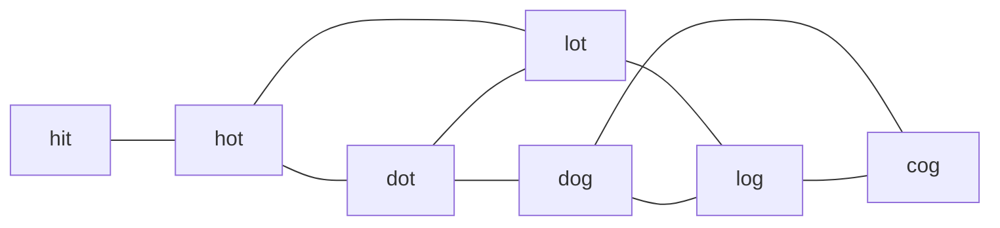

# Question 3: Bidirectional BFS for the Shortest Transformation Sequence in a Word Graph

[← Back to Lab 11 overview](../README.md)

## Contents

1. [Problem statement](#1-problem-statement)
2. [Reading the problem carefully](#2-reading-the-problem-carefully)
3. [File structure](#3-file-structure)
4. [Modelling the problem as a graph](#4-modelling-the-problem-as-a-graph)
5. [Input representation: wildcard-pattern buckets](#5-input-representation-wildcard-pattern-buckets)
6. [Why bidirectional BFS](#6-why-bidirectional-bfs)
7. [The algorithm](#7-the-algorithm)
8. [Correctness proof](#8-correctness-proof)
9. [Complexity analysis](#9-complexity-analysis)
10. [Worked example](#10-worked-example)
11. [Edge cases](#11-edge-cases)
12. [Alternatives that were considered](#12-alternatives-that-were-considered)
13. [Testing and measurements](#13-testing-and-measurements)
14. [Compile and run](#14-compile-and-run)
15. [Sample output](#15-sample-output)

---

## 1. Problem statement

A dictionary $D$ holds $N$ distinct words of the same length $L$. A *mutation* changes exactly one character of a word, and the result must again be a word of $D$. Given a start word $A$ and a target word $B$ (both of length $L$), find the smallest $k$ for which there is a sequence

$$
W_0=A,\ W_1,\ \dots,\ W_k=B
$$

where every $W_i$ with $i\ge 1$ belongs to $D$ and consecutive words differ in exactly one position (Hamming distance 1). If no such sequence exists, answer $-1$.

Constraints: $N\le 10^5$, $L\le 10$, all words consist of lowercase letters `a` to `z`.

---

## 2. Reading the problem carefully

The statement leaves a few points to the input constraints. The program makes these choices:

| Situation | Decision |
|---|---|
| $A$ not in $D$ | allowed (the classic "hit $\to$ cog" example). $A$ is added as an extra node so it can take its first step into $D$ |
| $B$ not in $D$ | the problem says $B$ must be in $D$, so the answer is $-1$ |
| $A=B$ and $B\in D$ | zero mutations: $k=0$ |
| Duplicate words in the input | the dictionary is a set, so duplicates are ignored |
| $k$ counts | the number of mutation **steps** (edges), so a sequence of $k+1$ words |
| Words of different lengths | rejected while reading the input |

The program also prints one shortest sequence, not only its length.

---

## 3. File structure

```
question 3/
├── question 3.c     the program (menu: 1 = enter input, 2 = generate input, 0 = exit)
├── a.out            compiled binary (Linux x86-64)
└── readme.md        this file
```

---

## 4. Modelling the problem as a graph

Define the **word graph** $G_D$: its vertices are the words of $D$ (plus $A$ if $A\notin D$), and two words are joined by an edge exactly when their Hamming distance is 1. Then

$$
k=\operatorname{dist}_{G_D}(A,B),
$$

the length of a shortest path from $A$ to $B$, and $k=-1$ if $B$ is unreachable. All edges have the same cost, so **breadth-first search** is the right tool.

A shortest path never uses $A$ as an intermediate word (that would repeat a vertex), so adding $A$ as a start node does not allow any sequence the statement forbids.

---

## 5. Input representation: wildcard-pattern buckets

The difficulty is not the search; it is finding the neighbours of a word quickly. For $N=10^5$ words and $L=10$:

| Way to find neighbours | Cost |
|---|---|
| compare every pair of words | $\Theta(N^2L)\approx 10^{11}$ character comparisons |
| try all $25L$ single-letter variants and look each up in a hash set | $\Theta(N\cdot 25L\cdot L)\approx 2.5\cdot 10^{8}$ character operations, plus a hash set |
| **wildcard-pattern buckets (used here)** | $\Theta(NL\log(NL))$ to build, then $O(NL)$ for the whole search |

### The pattern idea

Replace the letter at position $p$ of a word by a wildcard `*`. For example `hot` has the three patterns `*ot`, `h*t` and `ho*`.

**Lemma (patterns characterise neighbours).** Two distinct words $x\ne y$ of equal length are at Hamming distance 1 if and only if they share a pattern.

**Proof.** If they differ in exactly one position $p$, their patterns with a wildcard at $p$ are identical. Conversely, if they share a pattern with the wildcard at position $p$, they agree at every position except possibly $p$; since $x\ne y$ they differ at $p$, so their Hamming distance is exactly 1. $\blacksquare$

So every word is filed into $L$ **buckets**, one per pattern, and the neighbours of a word are simply the other members of its $L$ buckets. The explicit graph (which can have up to about $25NL$ adjacency entries) is never built; the buckets store only $NL$ entries in total.

### Exact 64-bit pattern keys

A pattern is packed into one integer by reading it as a number in **base 27**: the letters `a`..`z` are the digits $0..25$ and the wildcard is the digit $26$. Since

$$
27^{10}\approx 2.06\cdot 10^{14}<2^{63}\approx 9.22\cdot 10^{18},
$$

every pattern of length at most 10 fits in a `unsigned long long`, and distinct patterns get distinct keys, so there are **no hash collisions** at all. Producing the pattern key for position $p$ from the key $T$ of the whole word costs $O(1)$:

$$
\mathrm{key}_p=T-d_p\cdot 27^{\,L-1-p}+26\cdot 27^{\,L-1-p},
$$

where $d_p$ is the letter digit at position $p$. Dictionary words themselves are looked up with a base-26 key by binary search.

### How the index is built

1. Create the $N\cdot L$ entries `(key, word, position)`.
2. Sort them by key (`qsort`). Equal keys are now adjacent, and each run of equal keys is one bucket.
3. Store `bucketOf[word·L + position]` (the bucket id of each word/position pair) and the flat array `bnode[]` of bucket members.

The input format is: `N`, then the `N` words, then `A`, then `B`.

---

## 6. Why bidirectional BFS

A search from $A$ alone explores roughly a ball of radius $k$ around $A$. If every word has about $b$ neighbours, that ball has about $b^{k}$ words. Two searches, one from $A$ and one from $B$, that meet in the middle explore two balls of radius about $k/2$, that is about $2b^{k/2}$ words. The saving is exponential: the square root of the work in the idealised model.

It is not only theory. In a test dictionary of $10^5$ random words over a 4-letter alphabet with $L=10$, the connected component of the start word had $93\,483$ words, and the target was at distance $22$. The bidirectional search touched $2\,037$ words from $A$ and $1\,286$ from $B$, about $3\,300$ out of $93\,483$, which is roughly $3.5\%$ of the component, and it took $0.18$ s including reading the input.

To keep the two balls balanced, the program always expands the **smaller frontier** first.

---

## 7. The algorithm

```
if B not in D:            answer -1
if A == B:                answer 0
build the pattern index for D (plus A if A is not in D)

labelF[A] <- 0 ;  frontierF <- [A]            // search from A
labelB[B] <- 0 ;  frontierB <- [B]            // search from B
while both frontiers are non-empty:
    pick the side S with the smaller frontier (ties: forward)
    next <- []
    for each word x in frontier(S):
        for each position p in 0..L-1:
            bucket <- bucketOf[x, p]
            if bucket already scanned by S: continue
            mark bucket scanned by S
            for each word w in bucket, w != x:
                if w has a label from the OTHER side:
                    answer <- label_S[x] + 1 + label_other[w]       // searches meet
                    reconstruct and stop
                if w has no label from S:
                    label_S[w] <- label_S[x] + 1;  parent_S[w] <- x;  next.append(w)
    frontier(S) <- next
answer -1                                    // one side ran out of words
```

Details of `question 3.c`:

- A **bucket is scanned at most once per direction.** After the first scan every member of that bucket is labelled by that side, so a second scan could not discover anything new. This is what makes the work linear in the size of the index instead of the size of the explicit graph.
- Each word keeps a `parent` pointer for each direction, so the sequence is rebuilt by walking from the meeting words back to $A$ and to $B$.
- The program reports how many words each side labelled (an easy way to see the benefit of searching from both ends).

---

## 8. Correctness proof

Write $\delta_A(v)$ and $\delta_B(v)$ for the distance of $v$ from $A$ and from $B$.

**Facts about each side.** The skipping of scanned buckets does not stop a search from labelling any word it should label (members of a scanned bucket are already labelled). So each direction is an ordinary BFS: at any time, side $F$ has labelled exactly the words with $\delta_A\le a$ for some depth $a$ (with their correct labels), and side $B$ has labelled exactly the words with $\delta_B\le b$.

**Invariant (I): no word carries labels from both sides.** We show this holds until the moment the algorithm stops.

Suppose a bucket $Q$ was scanned earlier by $F$. At that moment every member of $Q$ got an $F$ label. If $B$ later reaches any member $y$ of $Q$ (through a neighbour $x'$ in one of its own buckets), then while scanning that bucket it sees that $y$ already has an $F$ label and **stops** (the meeting test). So $B$ can never label an $F$-labelled word, and symmetrically. Hence (I) holds throughout, and skipping scanned buckets can never hide a meeting: any word of a skipped bucket is already labelled by the skipping side, and the other side detects the meeting when it arrives.

**Lemma (no short path exists before the meeting).** If (I) holds, then $\operatorname{dist}(A,B)\ge a+b+1$.

*Proof.* Suppose $t=\operatorname{dist}(A,B)\le a+b$. Take a shortest $A$-$B$ path and let $x$ be its vertex at distance $j=\min(a,t)$ from $A$. Then $\delta_A(x)=j\le a$ and $\delta_B(x)=t-j\le b$, so $x$ would carry both labels, contradicting (I). $\blacksquare$

**Optimality of the first meeting.** Suppose side $F$ is expanding its frontier (all words with $\delta_A=a$) and finds a word $w$ already labelled by $B$ with $\delta_B(w)=c\le b$. The program reports $a+1+c$, the length of the path $A\leadsto x\to w\leadsto B$.

- This is a valid path, so $\operatorname{dist}(A,B)\le a+1+c\le a+1+b$.
- By the Lemma, $\operatorname{dist}(A,B)\ge a+b+1$.

So $a+1+c=a+b+1$ (in particular $c=b$) and the reported length equals $\operatorname{dist}(A,B)$. The argument is symmetric when $B$ is expanding.

**Termination without a meeting.** If a frontier becomes empty, that side has labelled its entire connected component. By (I) no word of that component carries a label of the other side, so $A$ and $B$ lie in different components: the answer is $-1$. $\blacksquare$

**The reconstructed sequence is valid.** Parents always point to words one step closer to the respective endpoint, so the sequence goes $A\to\dots\to x\to w\to\dots\to B$. Consecutive words share a bucket, hence differ in exactly one position, every word except $A$ belongs to $D$, and the sequence has $k+1$ words.

---

## 9. Complexity analysis

Let $n=N$ (plus one if $A\notin D$), $L\le 10$.

| Phase | Time | Space |
|---|---|---|
| Sort and de-duplicate the dictionary | $O(n\log n)$ | $O(n)$ |
| Create the $nL$ pattern entries | $O(nL)$ | $O(nL)$ entries |
| Sort the entries by key | $O(nL\log(nL))$ | in place |
| Assign buckets | $O(nL)$ | $O(nL)$ |
| Bidirectional BFS | $O(nL)$ (see below) | $O(n+nL)$ |
| Path reconstruction | $O(k)$ | $O(k)$ |

**BFS cost.** Each word is expanded at most once per direction; expanding it looks up its $L$ buckets, each in $O(1)$ through `bucketOf`. A bucket is scanned at most once per direction, and the total size of all buckets is exactly $nL$ (every word is in $L$ buckets). So each direction does $O(nL)$ work and the total is $O(nL)$.

$$
T(n,L)=O\bigl(nL\log(nL)\bigr),
$$

dominated by sorting the index. For $n=10^5$ and $L=10$ that is about $10^6\cdot 20=2\cdot 10^7$ elementary steps, which is why the whole program runs in a fraction of a second.

**Space.** With $n=10^5$ and $L=10$ there are $10^6$ index entries of 24 bytes each (24 MB). While the buckets are being assigned, these coexist with the three bucket arrays (`bucketOf`, `bnode`, `bstart`, 12 MB in total), so the peak is roughly 40 MB. The entry array is then freed and the search itself runs in about 20 MB. $\Theta(nL)$ overall.

**Worst case versus typical case.** In the worst case the two searches can still label almost every word (for example when $A$ and $B$ are in different components of a dense dictionary), so the bound above is also the worst-case bound of a one-directional BFS. The benefit of searching from both ends shows up as the **observed** number of words visited (Section 6).

---

## 10. Worked example

The dictionary $D=\lbrace$`hot`, `dot`, `dog`, `lot`, `log`, `cog`$\rbrace$, start word $A=$`hit` (**not** in $D$) and target $B=$`cog`.

Word graph (an edge means Hamming distance 1):



### Pattern buckets with at least two members

| Pattern | Members |
|---|---|
| `*ot` | dot, hot, lot |
| `*og` | cog, dog, log |
| `do*` | dog, dot |
| `lo*` | log, lot |
| `h*t` | hit, hot |

(Every other pattern, such as `c*g` or `ho*`, contains a single word and gives no neighbours.)

### Search trace

Words are numbered by sorted order: cog, dog, dot, hot, log, lot, and the extra start node hit. Both frontiers start with size 1, and ties go to the forward search.

| Round | Side | Frontier | Buckets scanned and result |
|---|---|---|---|
| 1 | from $A$ | `hit` | `h*t`: **hot** labelled at distance 1 |
| 2 | from $A$ (1 $\le$ 1) | `hot` | `*ot`: **dot** and **lot** labelled at distance 2; `h*t` already scanned |
| 3 | from $B$ (frontier 1 < 2) | `cog` | `*og`: **dog** and **log** labelled at distance 1 from $B$ |
| 4 | from $A$ (2 $\le$ 2) | `dot`, `lot` | scanning `dot`: `*ot` already scanned, then `do*` contains **dog**, which carries a label from $B$ (distance 1). **Meeting** |

The meeting gives

$$
k=\delta_A(\texttt{dot})+1+\delta_B(\texttt{dog})=2+1+1=4 .
$$

Following the parent pointers gives the sequence

$$
\texttt{hit}\to\texttt{hot}\to\texttt{dot}\to\texttt{dog}\to\texttt{cog}.
$$

Four words were labelled from $A$ (hit, hot, dot, lot) and three from $B$ (cog, dog, log), seven nodes in total.

---

## 11. Edge cases

| Case | Behaviour |
|---|---|
| $B\notin D$ | answer $-1$ |
| $A=B\in D$ | answer $0$ |
| $A\notin D$ | $A$ is added as an extra node, so its first mutation can lead into $D$ |
| $A$ equal to a dictionary word | no extra node needed |
| $A$ and $B$ already differ in one letter | $k=1$ |
| $A$ has no neighbours in $D$ | its frontier becomes empty, answer $-1$ |
| $B$ isolated in $D$ | the $B$-side frontier becomes empty, answer $-1$ |
| Duplicate dictionary words | ignored |
| $L=1$ | every single-letter word is adjacent to every other (pattern `*`); one bucket holds up to 26 words |
| $L=10$, $N=10^5$ | pattern keys still fit in 64 bits ($27^{10}\lt 2^{63}$) |
| Non-lowercase characters, wrong length | rejected while reading the input |

---

## 12. Alternatives that were considered

1. **Unidirectional BFS over an explicit graph built by pairwise comparison.** $\Theta(N^2L)$ preprocessing.
2. **Unidirectional BFS generating all $25L$ variants of each word** and checking a hash set. Correct and simple, but about $25L$ hash look-ups per expanded word, and it needs a hash table.
3. **Bidirectional BFS with variant generation.** Faster in practice than 2, but still pays the $25L$ factor on every expansion. The bucket index pays the index cost once and then scans each bucket only once per side.
4. **A hash table instead of sorting for the buckets.** Expected $O(nL)$ build time instead of $O(nL\log nL)$, at the price of a more complex hand-written table; the exact base-27 keys make sorting simple and collision-free, and at the limits it takes only a fraction of a second.

---

## 13. Testing and measurements

- **Correctness.** 600 random dictionaries (word lengths 1 to 4, alphabets of 2 or 3 letters, including targets outside the dictionary and start words outside the dictionary) were compared with a straightforward BFS using Hamming-distance checks. All lengths agreed, and every printed sequence was validated: it starts at $A$, ends at $B$, has $k+1$ words, every word after $A$ is in $D$, and each step changes exactly one letter.
- **Sanitizers.** The program ran under AddressSanitizer and UndefinedBehaviorSanitizer without reports.
- **Maximum size.** $N=10^5$, $L=10$, 4-letter alphabet, with $A$ and $B$ at distance 22: answer $22$ (matching an independent BFS), $0.18$ s total. A mid-range pair at distance 11 also matched.

---

## 14. Compile and run

```bash
gcc -O2 -Wall -Wextra "question 3.c" -o a.out
./a.out
```

The menu is: **1** enter input manually, **2** generate a random input, **0** exit.

---

## 15. Sample output

First run: the worked example of Section 10. Second run: a dictionary where $B$ cannot be reached (the answer is $-1$). Third run: one random run. Then exit. The random run is different on every execution.

```
===== Word Ladder (Bidirectional BFS) =====
1. Enter input manually
2. Generate input randomly
0. Exit
Choice: 1
Enter number of dictionary words N (1-100000): 6
Enter the 6 words (lowercase, all of the same length 1-10):
hot dot dog lot log cog
Enter start word A: hit
Enter target word B: cog

Dictionary: 6 unique words of length 3
Start A = hit, target B = cog

Minimum number of mutations k = 4
One shortest sequence: hit -> hot -> dot -> dog -> cog
Words reached: 4 from A, 3 from B (of 7 nodes)

===== Word Ladder (Bidirectional BFS) =====
1. Enter input manually
2. Generate input randomly
0. Exit
Choice: 1
Enter number of dictionary words N (1-100000): 3
Enter the 3 words (lowercase, all of the same length 1-10):
aaa bbb ccc
Enter start word A: aab
Enter target word B: ccc

Dictionary: 3 unique words of length 3
Start A = aab, target B = ccc

No valid transformation sequence exists -> k = -1
Words reached: 2 from A, 1 from B (of 4 nodes)

===== Word Ladder (Bidirectional BFS) =====
1. Enter input manually
2. Generate input randomly
0. Exit
Choice: 2
Generated random input: N = 21, L = 4, alphabet {a,b,c}
Words: aaac baab aabc baca aaba cbac acca bcbc cbcb baac bccc cbab bcbb baaa abcb cacc cbcc acba bcba cbbb ccba

Dictionary: 21 unique words of length 4
Start A = bcbb, target B = acca

Minimum number of mutations k = 3
One shortest sequence: bcbb -> bcba -> acba -> acca
Words reached: 3 from A, 2 from B (of 21 nodes)

===== Word Ladder (Bidirectional BFS) =====
1. Enter input manually
2. Generate input randomly
0. Exit
Choice: 0
```
